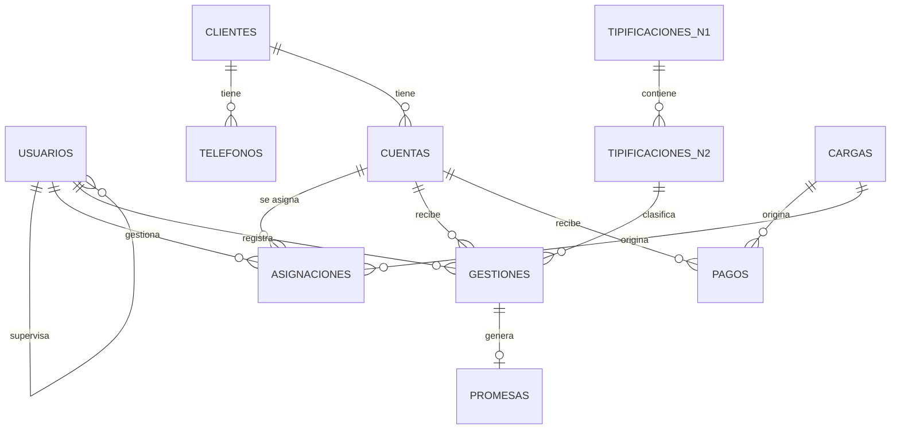

# 📞 CRM Web para la Gestión de Cobranzas — ESCALL PERÚ S.A.C.

Proyecto del curso **Desarrollo Web Integrado** (Grupo 3). Sistema que centraliza la operación de cobranza: búsqueda de clientes y cuentas, registro de gestiones con árbol de tipificaciones, promesas de pago, pagos, dashboard, reportes, administración de usuarios por rol e integración de archivos.

> **Estado actual (Avance 2):** esta entrega incluye el **backend (API REST)** y la **base de datos MySQL**. El frontend Angular se agrega en el Avance 3.

| Capa | Tecnología |
|---|---|
| Base de datos | **MySQL 8** |
| Backend (API REST) | **Java 21 + Spring Boot 4** · Spring Data JPA · Spring Security + JWT · Bean Validation |
| Frontend | Angular 21 + Bootstrap 5 — **Avance 3** (no incluido todavía) |
| Pruebas | JUnit 5 + MockMvc (integración) · colección **Postman** |

Informe y presentación del Avance 2: [`docs/avance-2/`](docs/avance-2/).

---

## ⚡ Probarlo en 1 minuto (sin MySQL)

Requisitos: **Java 21** (no hace falta Maven: el proyecto trae `mvnw`).

Doble clic en **`INICIAR-DEMO.bat`**. Se abre el backend en http://localhost:8080/api.

| Rol | Usuario | Contraseña | Qué ve |
|---|---|---|---|
| Administrador | `admin` | `Admin12345` | Todo |
| Supervisor | `sgarcia` | `Clave12345` | Su equipo (Lucía Torres y Carlos Medina) |
| Supervisor | `mrojas` | `Clave12345` | Su equipo (Valeria Quispe) |
| Asesor | `asesor1` / `asesor2` / `asesor3` | `Clave12345` | Su cartera |

> El modo **demo** usa una base H2 en memoria con 12 clientes, 15 cuentas y gestiones de los últimos 10 días. Se borra al apagar. La consola de la base está en http://localhost:8080/h2-console (JDBC `jdbc:h2:mem:crm`, usuario `sa`, sin contraseña).

Manual:

```bash
cd backend
./mvnw spring-boot:run -Dspring-boot.run.profiles=demo
```

Para probar la API, importa [`docs/CRM-Cobranzas.postman_collection.json`](docs/CRM-Cobranzas.postman_collection.json) en Postman y ejecuta *Login*: el token se guarda solo para las demás peticiones.

---

## 🗄️ Conectar con MySQL

1. Abre **MySQL Workbench** → tu conexión local → **File → Open SQL Script…** → [`database/01_esquema.sql`](database/01_esquema.sql) → ⚡ **Execute**. Se crea la base `crm_cobranzas` con 12 tablas y una vista.
2. Copia `backend/.env.example` como `backend/.env` y escribe tu contraseña de MySQL:
   ```properties
   MYSQL_URL=jdbc:mysql://localhost:3306/crm_cobranzas?serverTimezone=UTC&useSSL=false&allowPublicKeyRetrieval=true&characterEncoding=UTF-8
   MYSQL_USER=root
   MYSQL_PASSWORD=tu-contraseña
   JWT_SECRETO=un-texto-largo-y-aleatorio-de-al-menos-32-caracteres
   ADMIN_USUARIO=admin
   ADMIN_PASSWORD=UnaClaveSegura2026
   DATOS_DEMO=false
   ```
3. Doble clic en **`INICIAR-MYSQL.bat`**.

La primera vez, el backend crea el **administrador** (contraseña cifrada con BCrypt) y el **árbol de tipificaciones** base. Con `DATOS_DEMO=true` también carga el equipo y la cartera de ejemplo. Después, las asignaciones reales se cargan desde **Integración de Datos** (endpoint `POST /api/admin/integracion/asignaciones`).

> Para abrir el backend en **NetBeans**: *File → Open Project* → carpeta `backend` (se reconoce como proyecto Maven).

---

## ✅ Trazabilidad de requisitos

| Código | Requisito | Dónde está implementado (backend) |
|---|---|---|
| RF01 | Login con usuario y contraseña, sin registro público | `AuthController` · `AuthService` · `POST /api/auth/login` |
| RF02 | Cerrar sesión | `POST /api/auth/logout` (queda en auditoría) |
| RF03 | Buscar por documento y/o número de operación | `GET /api/clientes?q=` |
| RF04 | Datos generales y cuentas del cliente | `GET /api/clientes/{id}` |
| RF05 | Historial de gestiones | Incluido en `GET /api/clientes/{id}` |
| RF06 | Pagos por cuenta | Incluidos en `GET /api/clientes/{id}` |
| RF07 | Registrar gestión (fecha/hora, teléfono, cuenta, N1, N2, observación) | `POST /api/gestiones` |
| RF08 | Compromiso obligatorio si la tipificación lo exige | `GestionService.crearPromesa` |
| RF09 | N2 depende de N1 | `TipificacionN2.n1` · `GET /api/tipificaciones` |
| RF10–RF12 | Dashboard con filtros diario/semanal/mensual, asesor, cartera y cosecha; indicadores de gestiones, contactos, promesas y pagos | `DashboardService` · `AlcanceConsulta` · `GET /api/dashboard` |
| RF13 | Reportes de gestiones, pagos y promesas | `ReporteService` · `GET /api/reportes/{gestiones\|pagos\|promesas}` (JSON; exportación pendiente) |
| RF14 / RF15 | Supervisor ve solo su equipo; administrador ve todo | `UsuarioActual.asesoresVisibles` |
| RF16 | Supervisor administra solo a sus asesores | `UsuarioService.buscarGestionable` |
| RF17 | Administrador administra supervisores y asesores | `UsuarioService` · `/api/usuarios` |
| RF18–RF21 | Integración de Datos: carga de asignaciones y pagos; valida estructura, obligatorios y duplicados; muestra aceptados y rechazados | `IntegracionService` · `LectorCsv` · `/api/admin/integracion` |
| RF22 | Mantener el árbol de tipificaciones (activo/inactivo) | `TipificacionService` · `/api/admin/tipificaciones` (DELETE desactiva) |
| RF23 | Auditoría de acciones críticas | `AuditoriaService` · `GET /api/admin/auditoria` |
| RNF01 | Controller / Service / Repository / Model | Paquetes `controlador`, `servicio`, `repositorio`, `modelo` |
| RNF04 | Responsivo con Bootstrap | Avance 3 (frontend) |
| RNF05 / RNF06 | Acceso por rol · contraseñas con hash | `@PreAuthorize` + JWT · BCrypt |
| RNF07 | Validación de cargas | `IntegracionService` (fila por fila) |
| RNF10 | Trazabilidad de gestiones | `gestiones` guarda fecha/hora, asesor, cuenta, teléfono, N1, N2 y observación |

---

## 🔐 Matriz de permisos por rol

| Módulo / acción | Asesor | Supervisor | Administrador |
|---|:-:|:-:|:-:|
| Resumen (buscar cliente) | Su cartera | Su equipo | Todo |
| Registrar gestión | ✅ (solo sus cuentas) | — | — |
| Mi cartera y agenda de promesas | ✅ | — | — |
| Dashboard y Reportes | — | Su equipo | Todo |
| Usuarios | — | Sus asesores | Supervisores y asesores |
| Tipificaciones | — | — | ✅ |
| Integración de Datos | — | — | ✅ |
| Auditoría | — | — | ✅ |

La regla se aplica **en el backend**: `@PreAuthorize` en cada controlador y el filtro de asesores visibles en cada servicio.

---

## 🏗️ Arquitectura (MVC por capas)

```mermaid
flowchart LR
    U[Cliente HTTP<br/>Postman · Angular (Avance 3)] -->|REST / JSON + JWT| C[Controller]
    subgraph Spring Boot 4 — localhost:8080
      C --> S[Service<br/>reglas de negocio]
      S --> R[Repository<br/>Spring Data JPA]
      R --> M[Model / Entity]
    end
    R -->|JDBC| D[(MySQL 8<br/>crm_cobranzas)]
```

```
backend/src/main/java/com/escall/crm/
├── controlador/   AuthController, ResumenController, SupervisionController,
│                  UsuarioController, AdministracionController
├── servicio/      ClienteService, GestionService, DashboardService, ReporteService,
│                  UsuarioService, TipificacionService, IntegracionService, AuditoriaService
├── repositorio/   Interfaces JPA (consultas con filtros por rol y periodo)
├── modelo/        Usuario, Cliente, Telefono, Cuenta, Asignacion, TipificacionN1/N2,
│                  Gestion, Promesa, Pago, Carga, Auditoria
├── dto/           Objetos de entrada/salida con validaciones
├── seguridad/     JWT, reglas de acceso, UsuarioActual (alcance por rol)
├── excepcion/     Errores en español con formato único
├── config/        Datos iniciales, reloj (zona America/Lima)
└── util/          Lector de CSV
```

### Modelo entidad-relación

Diagrama completo en [`docs/avance-2/diagrama-er.png`](docs/avance-2/diagrama-er.png).



---

## 🔌 API REST

| Método | Endpoint | Rol | Descripción |
|---|---|---|---|
| POST | `/api/auth/login` | Público | Inicia sesión y devuelve el JWT |
| POST | `/api/auth/logout` | Todos | Cierra sesión (auditado) |
| GET | `/api/auth/yo` | Todos | Usuario actual |
| GET | `/api/clientes?q=` | Todos | Buscar cliente |
| GET | `/api/clientes/{id}` | Todos | Detalle: cuentas, gestiones, pagos y promesas |
| GET | `/api/tipificaciones` | Todos | Árbol activo |
| POST | `/api/gestiones` | Asesor | Registrar gestión (+ promesa) |
| GET | `/api/cartera` · `/api/cartera/agenda` | Asesor | Cartera y promesas pendientes |
| GET | `/api/dashboard` | Sup. / Admin | Indicadores (`periodo`, `desde`, `hasta`, `asesorId`, `cartera`, `cosecha`) |
| GET | `/api/filtros` | Sup. / Admin | Opciones de filtro |
| GET | `/api/reportes/{gestiones\|pagos\|promesas}` | Sup. / Admin | Reportes |
| GET · POST · PUT | `/api/usuarios` | Sup. / Admin | Listar, crear, editar |
| PATCH | `/api/usuarios/{id}/estado` · `/password` | Sup. / Admin | Activar/desactivar · restablecer contraseña |
| POST | `/api/clientes` | Admin | Crear cliente (sin cuentas; documento único) |
| PUT | `/api/clientes/{id}` | Quien ve al cliente | Actualizar nombre, correo y dirección |
| DELETE | `/api/clientes/{id}` | Admin | Eliminar cliente (solo si no tiene cuentas) |
| GET · POST · PUT · DELETE | `/api/admin/tipificaciones[/n1\|/n2]` | Admin | Árbol de tipificaciones (DELETE desactiva) |
| POST | `/api/admin/integracion/asignaciones` · `/pagos` | Admin | Cargar CSV |
| GET | `/api/admin/integracion/cargas` | Admin | Historial de cargas |
| GET | `/api/admin/auditoria` | Admin | Bitácora |

---

## 📥 Formato de archivos (Integración de Datos)

En Excel: **Guardar como → CSV UTF-8**. Separador `;` o `,`. Hay plantillas en [`docs/`](docs/).

- **Asignaciones:** `documento; tipo_documento; nombres; telefono; email; direccion; numero_operacion; entidad; producto; cartera; cosecha; deuda; dias_mora; asesor`
  - Crea o actualiza el cliente (por documento) y la cuenta (por operación). Si la cuenta cambia de asesor, la asignación anterior queda en el historial.
- **Pagos:** `numero_operacion; fecha_pago; monto; referencia`
  - Rechaza duplicados (misma operación, fecha, monto y referencia) y operaciones inexistentes. Cada pago **cumple automáticamente** las promesas pendientes de la cuenta.

---

## 🧠 Decisiones de diseño

| Situación | Solución |
|---|---|
| Un asesor no debe ver clientes de otros | Toda consulta filtra por `asesoresVisibles()` según el rol; sin acceso, la API responde 404 (no revela que el cliente existe). |
| La tipificación puede cambiar en el futuro | La gestión guarda N1 **y** N2 al registrarse (RNF10). Las tipificaciones no se borran: se desactivan. |
| Cambios de cartera entre asesores | `asignaciones` conserva el historial (`activa`, `fecha_fin`). |
| Archivos con errores | Se procesan fila por fila: lo válido entra y lo inválido se reporta con número de fila y motivo. |
| Promesas vencidas | El estado *VENCIDA* se calcula (pendiente con fecha pasada); no requiere procesos nocturnos. |
| Seguridad | JWT sin estado, BCrypt, `@PreAuthorize`, CORS restringido y auditoría de inicios de sesión (también los fallidos). |

---

## 🧪 Pruebas automáticas

```bash
cd backend
./mvnw test
```

[`CrmCobranzasApplicationTests`](backend/src/test/java/com/escall/crm/CrmCobranzasApplicationTests.java) verifica: login (RF01), permisos por rol (RNF05, RF14), que el asesor solo vea su cartera (RF03–RF04), la gestión con promesa y el pago que la cumple (RF07, RF08, RF20, RF21), la carga de asignaciones con validación (RF19, RF21), que el supervisor solo administre su equipo, con auditoría (RF16, RF23), que las tipificaciones se desactivan sin borrarse (RF22), las reglas del CRUD de clientes y que una carga sin archivo responda 400.

La colección de Postman se corre con newman (34 peticiones, cada una con aserción de código HTTP):

```bash
npx newman run docs/CRM-Cobranzas.postman_collection.json --env-var base_url=http://localhost:8080 --working-dir docs
```

El último reporte está en [`docs/avance-2/postman-resultados.txt`](docs/avance-2/postman-resultados.txt).
