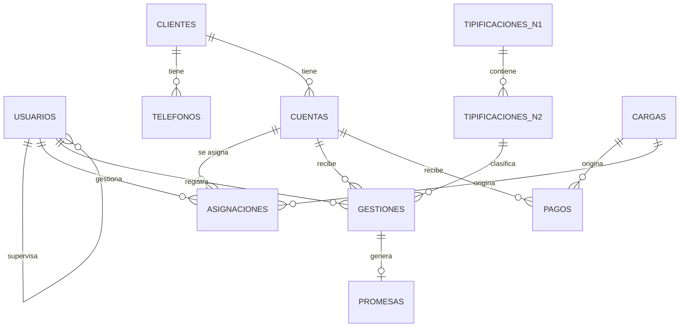

# 📞 CRM Web para la Gestión de Cobranzas — ESCALL PERÚ S.A.C.

Proyecto del curso **Desarrollo Web Integrado** (Grupo 3). Sistema que centraliza la operación de cobranza: búsqueda de clientes y cuentas, registro de gestiones con árbol de tipificaciones, promesas de pago, pagos, dashboard, reportes, administración de usuarios por rol e integración de archivos.

> Este repositorio contiene el **backend (API REST)** y el esquema de la base de datos. La interfaz Angular no forma parte del repositorio.

| Capa               | Tecnología                                                                              |
| ------------------ | --------------------------------------------------------------------------------------- |
| Base de datos      | **MySQL 8**                                                                             |
| Backend (API REST) | **Java 21 + Spring Boot 4** · Spring Data JPA · Spring Security + JWT · Bean Validation |
| Frontend           | Angular 21 + Bootstrap 5 — **Avance 3** (no incluido todavía)                           |
| Pruebas            | JUnit 5 + MockMvc y comprobación del contenedor con MySQL en CI                         |

---

## ⚡ Probarlo en 1 minuto (sin MySQL)

Requisitos: **Java 21** (no hace falta Maven: el proyecto trae `mvnw`).

Doble clic en **`INICIAR-DEMO.bat`**. Se abre el backend en http://localhost:8080/api.

| Rol           | Usuario                           | Contraseña   | Qué ve                                   |
| ------------- | --------------------------------- | ------------ | ---------------------------------------- |
| Administrador | `admin`                           | `Admin12345` | Todo                                     |
| Supervisor    | `sgarcia`                         | `Clave12345` | Su equipo (Lucía Torres y Carlos Medina) |
| Supervisor    | `mrojas`                          | `Clave12345` | Su equipo (Valeria Quispe)               |
| Asesor        | `asesor1` / `asesor2` / `asesor3` | `Clave12345` | Su cartera                               |

> El modo **demo** usa una base H2 en memoria con 12 clientes, 15 cuentas y gestiones de los últimos 10 días. Se borra al apagar. La consola de la base está en http://localhost:8080/h2-console (JDBC `jdbc:h2:mem:crm`, usuario `sa`, sin contraseña).

Manual:

```bash
cd backend
./mvnw spring-boot:run -Dspring-boot.run.profiles=demo
```

Para probar la API desde un cliente HTTP, inicia sesión en `POST /api/auth/login` con el usuario del modo demo. Envía el token recibido en la cabecera `Authorization: Bearer <token>` de las peticiones protegidas.

---

## 🗄️ Conectar con MySQL

1. Crea y selecciona una base MySQL llamada `ilustroc_universidad`. Ejecuta [`database/01_esquema.sql`](database/01_esquema.sql) con esa base seleccionada para crear las tablas y la vista.
2. Copia `backend/.env.example` como `backend/.env` y escribe tu contraseña de MySQL:
   ```properties
   MYSQL_URL=jdbc:mysql://localhost:3306/ilustroc_universidad?serverTimezone=UTC&useSSL=false&allowPublicKeyRetrieval=true&characterEncoding=UTF-8
   MYSQL_USER=root
   MYSQL_PASSWORD=tu-contraseña
   JWT_SECRETO=un-texto-largo-y-aleatorio-de-al-menos-32-caracteres
   ADMIN_USUARIO=admin
   ADMIN_PASSWORD=UnaClaveSegura2026
   DATOS_DEMO=false
   ```
3. Doble clic en **`INICIAR-MYSQL.bat`**.

La primera vez, el backend crea el **administrador** (contraseña cifrada con BCrypt) y el **árbol de tipificaciones** base. Con `DATOS_DEMO=true` también carga el equipo y la cartera de ejemplo. Después, las asignaciones reales se cargan desde **Integración de Datos** (endpoint `POST /api/admin/integracion/asignaciones`).

> Para abrir el backend en **NetBeans**: _File → Open Project_ → carpeta `backend` (se reconoce como proyecto Maven).

---

## Desplegar el backend en producción

1. Crea una base MySQL dedicada y ejecuta [`database/01_esquema.sql`](database/01_esquema.sql) con el usuario encargado del esquema. Para una base ya existente, respáldala y valida el esquema en una copia antes de actualizar. El perfil `prod` valida las tablas al arrancar.
2. Configura los valores en el gestor de secretos del hosting. Usa una cuenta de aplicación con permisos de lectura y escritura sobre la base, separada de la cuenta que aplica el esquema. Configura TLS para la conexión MySQL según tu proveedor.

   | Variable | Uso |
   | --- | --- |
   | `MYSQL_URL`, `MYSQL_USER`, `MYSQL_PASSWORD` | Conexión JDBC y credenciales del usuario de aplicación. |
   | `JWT_SECRETO` | Clave privada aleatoria de al menos 32 bytes. Por ejemplo, genera una con `openssl rand -hex 32`. |
   | `ADMIN_PASSWORD` | Contraseña inicial de entre 16 y 72 bytes, necesaria si todavía no hay usuarios. Puedes retirarla del entorno después del primer arranque. |
   | `ADMIN_USUARIO` | Nombre del administrador inicial. El valor predeterminado es `admin`. |
   | `CORS_ORIGENES` | Lista opcional de orígenes HTTPS exactos separados por comas. Déjala vacía si no necesitas acceso desde otro origen. |
   | `PORT` | Puerto HTTP. El valor predeterminado es `8080`. |

3. Construye la imagen desde la raíz con `docker build -t crm-cobranzas backend`. La imagen usa el perfil `prod` y un usuario sin privilegios. Ejecuta una sola réplica durante la creación del administrador inicial. Para usar el JAR en un host con Java 21, inicia con `java -jar backend/target/crm-cobranzas-0.0.1-SNAPSHOT.jar --spring.profiles.active=prod`.
4. Usa `GET /actuator/health/readiness` para monitorizar la disponibilidad de la base. Publica la API detrás de HTTPS y limita los intentos de inicio de sesión en el proxy. Prueba el acceso con cada rol en un entorno de ensayo antes de cargar datos reales.

El perfil `prod` excluye la consola H2 y los datos demo. Si vienes de un entorno de desarrollo, usa una base nueva o revisa primero los usuarios y datos existentes.

Los tokens duran una hora por defecto. Cerrar sesión registra el evento en auditoría y el cliente debe descartar el token. Un token emitido sigue siendo válido hasta su vencimiento.

## ✅ Trazabilidad de requisitos

| Código        | Requisito                                                                                                                         | Dónde está implementado (backend)                                                                 |
| ------------- | --------------------------------------------------------------------------------------------------------------------------------- | ------------------------------------------------------------------------------------------------- |
| RF01          | Login con usuario y contraseña, sin registro público                                                                              | `AuthController` · `AuthService` · `POST /api/auth/login`                                         |
| RF02          | Cerrar sesión                                                                                                                     | `POST /api/auth/logout` (queda en auditoría)                                                      |
| RF03          | Buscar por documento y/o número de operación                                                                                      | `GET /api/clientes?q=`                                                                            |
| RF04          | Datos generales y cuentas del cliente                                                                                             | `GET /api/clientes/{id}`                                                                          |
| RF05          | Historial de gestiones                                                                                                            | Incluido en `GET /api/clientes/{id}`                                                              |
| RF06          | Pagos por cuenta                                                                                                                  | Incluidos en `GET /api/clientes/{id}`                                                             |
| RF07          | Registrar gestión (fecha/hora, teléfono, cuenta, N1, N2, observación)                                                             | `POST /api/gestiones`                                                                             |
| RF08          | Compromiso obligatorio si la tipificación lo exige                                                                                | `GestionService.crearPromesa`                                                                     |
| RF09          | N2 depende de N1                                                                                                                  | `TipificacionN2.n1` · `GET /api/tipificaciones`                                                   |
| RF10–RF12     | Dashboard con filtros diario/semanal/mensual, asesor, cartera y cosecha; indicadores de gestiones, contactos, promesas y pagos    | `DashboardService` · `AlcanceConsulta` · `GET /api/dashboard`                                     |
| RF13          | Reportes de gestiones, pagos y promesas                                                                                           | `ReporteService` · `GET /api/reportes/{gestiones\|pagos\|promesas}` (JSON; exportación pendiente) |
| RF14 / RF15   | Supervisor ve solo su equipo; administrador ve todo                                                                               | `UsuarioActual.asesoresVisibles`                                                                  |
| RF16          | Supervisor administra solo a sus asesores                                                                                         | `UsuarioService.buscarGestionable`                                                                |
| RF17          | Administrador administra supervisores y asesores                                                                                  | `UsuarioService` · `/api/usuarios`                                                                |
| RF18–RF21     | Integración de Datos: carga de asignaciones y pagos; valida estructura, obligatorios y duplicados; muestra aceptados y rechazados | `IntegracionService` · `LectorCsv` · `/api/admin/integracion`                                     |
| RF22          | Mantener el árbol de tipificaciones (activo/inactivo)                                                                             | `TipificacionService` · `/api/admin/tipificaciones` (DELETE desactiva)                            |
| RF23          | Auditoría de acciones críticas                                                                                                    | `AuditoriaService` · `GET /api/admin/auditoria`                                                   |
| RNF01         | Controller / Service / Repository / Model                                                                                         | Paquetes `controlador`, `servicio`, `repositorio`, `modelo`                                       |
| RNF04         | Responsivo con Bootstrap                                                                                                          | Avance 3 (frontend)                                                                               |
| RNF05 / RNF06 | Acceso por rol · contraseñas con hash                                                                                             | `@PreAuthorize` + JWT · BCrypt                                                                    |
| RNF07         | Validación de cargas                                                                                                              | `IntegracionService` (fila por fila)                                                              |
| RNF10         | Trazabilidad de gestiones                                                                                                         | `gestiones` guarda fecha/hora, asesor, cuenta, teléfono, N1, N2 y observación                     |

---

## 🔐 Matriz de permisos por rol

| Módulo / acción                 |        Asesor         |  Supervisor  |      Administrador      |
| ------------------------------- | :-------------------: | :----------: | :---------------------: |
| Resumen (buscar cliente)        |      Su cartera       |  Su equipo   |          Todo           |
| Registrar gestión               | ✅ (solo sus cuentas) |      —       |            —            |
| Mi cartera y agenda de promesas |          ✅           |      —       |            —            |
| Dashboard y Reportes            |           —           |  Su equipo   |          Todo           |
| Usuarios                        |           —           | Sus asesores | Supervisores y asesores |
| Tipificaciones                  |           —           |      —       |           ✅            |
| Integración de Datos            |           —           |      —       |           ✅            |
| Auditoría                       |           —           |      —       |           ✅            |

La regla se aplica **en el backend**: `@PreAuthorize` en cada controlador y el filtro de asesores visibles en cada servicio.

---

## 🏗️ Arquitectura (MVC por capas)

```mermaid
flowchart LR
    U[Cliente HTTP<br/>Postman · Angular (Avance 3)] -->|REST / JSON + JWT| C[Controller]
    subgraph Spring Boot 4 — localhost:8080
      C --> S[Service<br/>reglas de negocio]
      S --> R[Repository<br/>Spring Data JPA]
      R --> M[Model / Entity]
    end
    R -->|JDBC| D[(MySQL 8<br/>ilustroc_universidad)]
```

```
backend/src/main/java/com/escall/crm/
├── controlador/   AuthController, ResumenController, SupervisionController,
│                  UsuarioController, AdministracionController
├── servicio/      ClienteService, GestionService, DashboardService, ReporteService,
│                  UsuarioService, TipificacionService, IntegracionService, AuditoriaService
├── repositorio/   Interfaces JPA (consultas con filtros por rol y periodo)
├── modelo/        Usuario, Cliente, Telefono, Cuenta, Asignacion, TipificacionN1/N2,
│                  Gestion, Promesa, Pago, Carga, Auditoria
├── dto/           Objetos de entrada/salida con validaciones
├── seguridad/     JWT, reglas de acceso, UsuarioActual (alcance por rol)
├── excepcion/     Errores en español con formato único
├── config/        Datos iniciales, reloj (zona America/Lima)
└── util/          Lector de CSV
```

### Modelo entidad-relación



---

## 🔌 API REST

| Método                    | Endpoint                                         | Rol                 | Descripción                                                                 |
| ------------------------- | ------------------------------------------------ | ------------------- | --------------------------------------------------------------------------- |
| POST                      | `/api/auth/login`                                | Público             | Inicia sesión y devuelve el JWT                                             |
| POST                      | `/api/auth/logout`                               | Todos               | Cierra sesión (auditado)                                                    |
| GET                       | `/api/auth/yo`                                   | Todos               | Usuario actual                                                              |
| GET                       | `/api/clientes?q=`                               | Todos               | Buscar cliente                                                              |
| GET                       | `/api/clientes/{id}`                             | Todos               | Detalle: cuentas, gestiones, pagos y promesas                               |
| GET                       | `/api/tipificaciones`                            | Todos               | Árbol activo                                                                |
| POST                      | `/api/gestiones`                                 | Asesor              | Registrar gestión (+ promesa)                                               |
| GET                       | `/api/cartera` · `/api/cartera/agenda`           | Asesor              | Cartera y promesas pendientes                                               |
| GET                       | `/api/dashboard`                                 | Sup. / Admin        | Indicadores (`periodo`, `desde`, `hasta`, `asesorId`, `cartera`, `cosecha`) |
| GET                       | `/api/filtros`                                   | Sup. / Admin        | Opciones de filtro                                                          |
| GET                       | `/api/reportes/{gestiones\|pagos\|promesas}`     | Sup. / Admin        | Reportes                                                                    |
| GET · POST · PUT          | `/api/usuarios`                                  | Sup. / Admin        | Listar, crear, editar                                                       |
| PATCH                     | `/api/usuarios/{id}/estado` · `/password`        | Sup. / Admin        | Activar/desactivar · restablecer contraseña                                 |
| POST                      | `/api/clientes`                                  | Admin               | Crear cliente (sin cuentas; documento único)                                |
| PUT                       | `/api/clientes/{id}`                             | Quien ve al cliente | Actualizar nombre, correo y dirección                                       |
| DELETE                    | `/api/clientes/{id}`                             | Admin               | Eliminar cliente (solo si no tiene cuentas)                                 |
| GET · POST · PUT · DELETE | `/api/admin/tipificaciones[/n1\|/n2]`            | Admin               | Árbol de tipificaciones (DELETE desactiva)                                  |
| POST                      | `/api/admin/integracion/asignaciones` · `/pagos` | Admin               | Cargar CSV                                                                  |
| GET                       | `/api/admin/integracion/cargas`                  | Admin               | Historial de cargas                                                         |
| GET                       | `/api/admin/auditoria`                           | Admin               | Bitácora                                                                    |

---

## 📥 Formato de archivos (Integración de Datos)

En Excel: **Guardar como → CSV UTF-8**. Separador `;` o `,`.

- **Asignaciones:** `documento; tipo_documento; nombres; telefono; email; direccion; numero_operacion; entidad; producto; cartera; cosecha; deuda; dias_mora; asesor`
  - Crea o actualiza el cliente (por documento) y la cuenta (por operación). Si la cuenta cambia de asesor, la asignación anterior queda en el historial.
- **Pagos:** `numero_operacion; fecha_pago; monto; referencia`
  - Rechaza duplicados (misma operación, fecha, monto y referencia) y operaciones inexistentes. Cada pago **cumple automáticamente** las promesas pendientes de la cuenta.

---

## 🧠 Decisiones de diseño

| Situación                                  | Solución                                                                                                                       |
| ------------------------------------------ | ------------------------------------------------------------------------------------------------------------------------------ |
| Un asesor no debe ver clientes de otros    | Toda consulta filtra por `asesoresVisibles()` según el rol; sin acceso, la API responde 404 (no revela que el cliente existe). |
| La tipificación puede cambiar en el futuro | La gestión guarda N1 **y** N2 al registrarse (RNF10). Las tipificaciones no se borran: se desactivan.                          |
| Cambios de cartera entre asesores          | `asignaciones` conserva el historial (`activa`, `fecha_fin`).                                                                  |
| Archivos con errores                       | Se procesan fila por fila: lo válido entra y lo inválido se reporta con número de fila y motivo.                               |
| Promesas vencidas                          | El estado _VENCIDA_ se calcula (pendiente con fecha pasada); no requiere procesos nocturnos.                                   |
| Seguridad                                  | JWT sin estado, BCrypt, `@PreAuthorize`, CORS restringido y auditoría de inicios de sesión (también los fallidos).             |

---

## 🧪 Pruebas automáticas

```bash
cd backend
sh ./mvnw verify
```

[`CrmCobranzasApplicationTests`](backend/src/test/java/com/escall/crm/CrmCobranzasApplicationTests.java) verifica: login (RF01), permisos por rol (RNF05, RF14), que el asesor solo vea su cartera (RF03–RF04), la gestión con promesa y el pago que la cumple (RF07, RF08, RF20, RF21), la carga de asignaciones con validación (RF19, RF21), que el supervisor solo administre su equipo, con auditoría (RF16, RF23), que las tipificaciones se desactivan sin borrarse (RF22), las reglas del CRUD de clientes y que una carga sin archivo responda 400.

[`ProduccionTests`](backend/src/test/java/com/escall/crm/ProduccionTests.java) comprueba el arranque sin datos demo, que la consola H2 quede inaccesible y que CORS acepte solo el origen configurado. GitHub Actions también construye el contenedor y comprueba el inicio de sesión y el estado de disponibilidad con MySQL 8.4.
